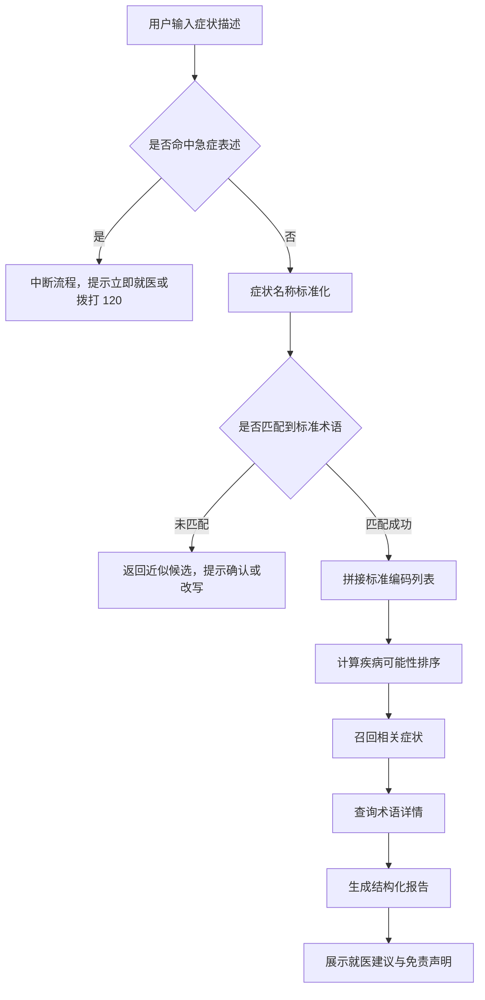
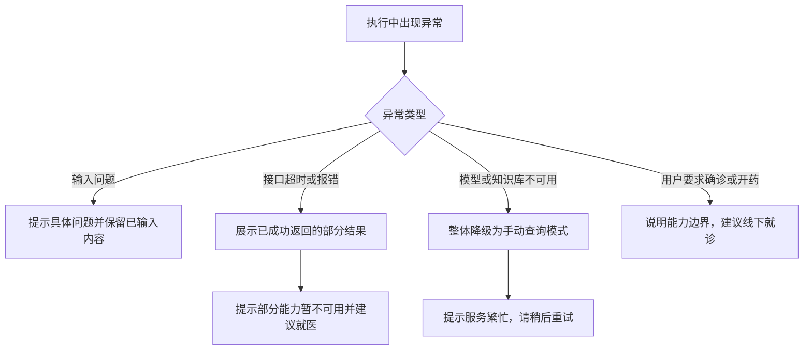
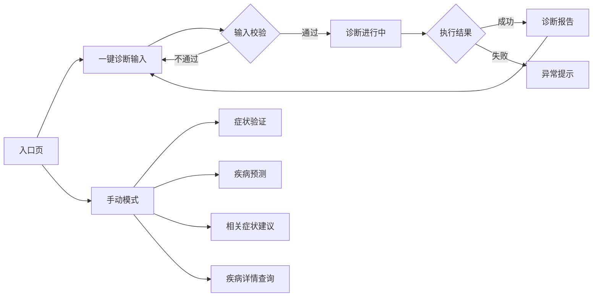

# 医疗诊断辅助系统 产品需求文档

| 项目   | 内容                                    |
| ---- | ------------------------------------- |
| 产品名称 | 医疗诊断辅助系统（Medical Diagnosis Assistant） |
| 文档版本 | V2.1（精简版）                             |
| 文档状态 | 已评审                                   |
| 作者   | 杨晴晴                                   |
| 更新日期 | 2026-10-13                            |
| 适用范围 | 网页端（Gradio）、接口调用方、扣子（Coze）Agent 工作流   |

**修订记录**

| 版本   | 日期         | 修订说明与关键决策                                                |
| ---- | ---------- | -------------------------------------------------------- |
| V1.0 | 2026-07-08 | 首版，定义 5 个接口与 4 个查询模块。选择把能力拆成独立接口而非单体流程，为后续集成留空间          |
| V1.2 | 2026-08-19 | 新增「一键诊断」，4 步合并为 1 步。依据：试用中发现非专业用户无法完成跨模块复制编码（见 7.4 决策 1） |
| V1.3 | 2026-09-02 | 后端服务化上云，接口兼容查询参数。依据：低代码平台只能填 URL 与参数表，集成成本优先             |
| V2.0 | 2026-10-13 | 新增 Agent 工具化与编排。产品侧只保证"工具可用、边界清晰"，不把推理逻辑写死               |
| V2.1 | 2026-10-13 | 补充调研证据、临床价值指标、合规评估、Bad Case 与关键决策、离线评测方案                 |

---

## 一、背景与目标

### 1.1 背景

用户身体不适时会先自行搜索，但搜索结果质量参差、容易放大恐慌，也无法针对"这几个症状组合起来可能是什么"给出结构化判断。现有 AI 问诊产品多由大模型直接给出结论，存在三个障碍：

1. **结论不可追溯**——用户看不到依据，医生不认结论；
2. **术语无法对齐**——用户说"发烧"，知识库里是 Fever（C0015967），口语与标准术语之间没有映射；
3. **数据需要上云**——对数据敏感的使用方而言，把健康描述发给外部服务是直接否决项。

据此定义四个核心问题：

| 编号  | 问题                   | 影响                |
| --- | -------------------- | ----------------- |
| P1  | 口语症状与标准医学术语无法对齐      | 主流程直接中断，是最大体验断点   |
| P2  | 用户要的不是"确诊"，而是"要不要就医" | 结论越肯定，误导风险越大      |
| P3  | 判断依据不透明，使用方不敢采信      | 无法进入专业场景          |
| P4  | 需在多个模块间手动传递编码        | 非专业用户难以完成，流失在中间步骤 |

### 1.2 调研方法与证据

本节说明 1.1 节问题定义的信息来源：

| 方法        | 覆盖范围                  | 支撑的判断 / 局限                       |
| --------- | --------------------- | -------------------------------- |
| 竞品公开资料拆解  | 国内外 15 款症状自查与 AI 问诊产品 | 支撑结果呈现方式与分诊建议的必要性；未做全量实测，竞品可能已变化 |
| 医学标准与监管资料 | UMLS 编码体系、AI 辅助诊断监管资料 | 支撑术语标准化必要性与合规边界（见 6.4）；二手资料      |
| 自用与同侪试用   | 本人及少量非医学背景同学          | 支撑主流程断点判断；样本小、非随机、无结构化记录         |
| 从业者访谈     | 未开展                   | 待 V2 补充                          |

**结论与局限**：本期**未开展正式用户调研**（无提纲、无配额、无统计分析），上述信息仅作为**设计假设的来源**，不是需求已验证的证据。1.1 节的问题定义与 1.4 节的指标目标，需在 V2 通过 5~8 人结构化访谈与可用性测试验证，原始记录另见《用户调研报告》。

### 1.3 产品定位与边界

**定位**：面向症状自查场景的辅助判断工具，输出以可能性排序为主的可解释结果；同时把能力标准化，供第三方以接口或 Agent 工具集成。

**明确不做**：不出具诊断结论；不提供用药、剂量、停药建议；不承接急症、创伤、中毒类咨询（命中即转就医指引）；不替代医生，不用于临床决策。

**本期不做**：账号与登录体系（工具形态无需身份识别）；多轮追问与症状澄清（优先保证单轮准确）；检验单与影像识别（资质与数据门槛高）；医院 HIS 对接（需院内资质与安全评估）。

### 1.4 目标与指标

| 产品指标    | 现状  | 目标         |
| ------- | --- | ---------- |
| 完整报告生成率 | 未统计 | ≥ 90%      |
| 症状识别率   | 未统计 | ≥ 85%      |
| 端到端响应耗时 | 秒级  | P95 ≤ 15 秒 |
| 工具调用成功率 | 未统计 | ≥ 95%      |
| 报告页返回率  | 未统计 | 记录基线       |

**临床价值指标（本期不采集，先定义衡量方式）**

| 临床价值目标                | 衡量方式             | 现状  |
| --------------------- | ---------------- | --- |
| 减少因描述不清导致的无效查询        | 症状标准化成功率（按中英文分组） | 未采集 |
| 降低"过度焦虑"（看到高可能性结果后恐慌） | 报告页停留时长、就医建议展开率  | 未采集 |
| 减少"该就医却延误"            | 急症拦截次数、拦截后继续操作比例 | 未采集 |
| 建议就医的转化               | 报告页"是否就医"自报告比例   | 未采集 |
| 降低术语理解成本              | 术语查询成功率          | 未采集 |

> 基线待埋点上线后回填，不预设乐观数字。本产品不进入临床决策路径，**不宣称任何临床效果**；上述属行为层证据，若要证明临床效果需开展规范临床研究，不在本期范围。

---

## 二、用户与使用场景

### 2.1 目标用户与用户故事

| 用户类型      | 使用场景                 | 核心诉求            |
| --------- | -------------------- | --------------- |
| 普通用户      | 出现发热、咳嗽、乏力等症状，想先判断轻重 | 快速知道可能方向、是否需要就医 |
| 集成方（开发者）  | 把症状判断能力接进自有应用或 Agent | 标准接口、可私有化、结果可追溯 |
| 医学生与初级从业者 | 查询症状与疾病关联、核对术语       | 术语标准、编码可查       |

| 编号    | 用户故事                   | 验收要点                   |
| ----- | ---------------------- | ---------------------- |
| US-01 | 用中文描述症状就能得到结果，不必先学医学术语 | 输入"发烧、咳嗽"可返回结果，无需英文    |
| US-02 | 一次操作拿到完整结果，不必跨页面复制编码   | 单次提交产出完整报告             |
| US-03 | 知道什么情况必须去医院            | 报告含就医建议；急症输入直接转就医提示    |
| US-04 | 看到判断依据，以便判断结果是否可信      | 每个疾病显示可能性与相关症状，详情可查    |
| US-05 | 集成方能拿到结构化结果，且数据不出本地    | 接口返回结构化 JSON；支持容器化私有部署 |

### 2.2 主场景

连续两天发热并伴随咳嗽、乏力的用户，在输入框填入"发烧、咳嗽、浑身没劲"并提交。系统依次完成症状标准化与疾病可能性计算，返回一份报告：已识别症状及其标准编码、按可能性排序的疾病列表（含可能性与相关症状）、相关症状提示、术语说明，以及"症状持续超过三天或出现呼吸困难请及时就医"的提示。另有两个次要场景：集成方把四项能力注册为工具供自有 Agent 调用；医学生输入"fever"获取标准名称与 CUI 后查询疾病详情。

---

## 三、功能与优先级

### 3.1 功能清单

| 模块       | 功能                 | 说明                           | 优先级 |
| -------- | ------------------ | ---------------------------- | --- |
| 症状标准化    | 症状名转标准编码           | 支持中英文；精确匹配失败时返回近似候选；内置中文症状映射 | P0  |
| 疾病预测     | 症状组合转疾病可能性排序       | 输出排序及对应可能性，附带相关症状            | P0  |
| 相关症状推荐   | 按症状推荐相关症状          | 基于语义相似度召回，阈值 0.6             | P1  |
| 疾病详情     | 按编码查询术语详情          | 返回标准名称、语言、来源等                | P1  |
| 一键诊断     | 一次提交产出完整报告         | 串联上述四项能力，替代 4 步手动操作          | P0  |
| 安全边界     | 急症识别与就医引导          | 命中急症表述时不进入诊断流程               | P0  |
| 安全边界     | 免责声明固定展示           | 结果页常驻                        | P0  |
| 服务化      | 云端部署、接口开放、容器化私有部署  | 支持外部调用与数据不出本地                | P0  |
| Agent 集成 | 能力封装为 4 个工具并支持失败降级 | 工具异常时如实告知，不编造结果              | P0  |
| Agent 集成 | 工具调用评测集覆盖          | 4 个工具的正常与异常分支均有用例            | P0  |
| 异常兜底     | 输入校验与错误提示          | 空输入、格式错误、超时等                 | P0  |
| 数据       | 埋点与指标统计            | 记录关键行为用于评估                   | P2  |

### 3.2 优先级判断依据

按"对主流程的阻断程度 × 实现成本"划分：

- **P0（阻断项）**：不做则主流程无法完成——症状标准化、一键诊断、安全边界。安全边界虽不提升体验，但缺失会造成合规风险，故与核心功能同级。
- **P1（体验项）**：影响结果完整度与信任度——相关症状推荐、疾病详情、容器化私有部署。
- **P2（增强项）**：不影响主流程——埋点统计的完整度、结果分享。

依赖关系决定实现顺序：疾病预测依赖症状标准化，一键诊断依赖前四项能力，Agent 工具化依赖接口稳定。

---

## 四、业务流程与页面流程

### 4.1 主流程

两个关键判断点：**急症判断前置**——放在流程最前端，避免用户先看到"可能性不高"而放弃就医；**标准化失败不阻断**——单个症状未匹配时其余症状继续计算，未识别项单独提示，避免一个错别字导致整次诊断失败。

### 4.2 异常与降级流程

### 4.3 页面流程

---

## 五、原型与交互说明

### 5.1 页面清单

| 序号  | 页面       | 页面目标      | 主要元素                                 |
| --- | -------- | --------- | ------------------------------------ |
| 1   | 入口页      | 说明用途，引导开始 | 产品名、一句话说明、开始自查按钮、免责声明                |
| 2   | 一键诊断输入   | 收集症状描述    | 多行输入框、分隔符提示、常用症状标签、开始诊断按钮            |
| 3   | 诊断进行中    | 反馈执行进度    | 加载状态、阶段提示、预计耗时说明                     |
| 4   | 诊断报告     | 呈现完整结果    | 已识别症状、疾病列表（含可能性）、相关症状、术语详情、就医建议、免责声明 |
| 5   | 症状验证     | 症状名转标准编码  | 输入框、验证按钮、结果卡                         |
| 6   | 疾病预测     | 按编码查询疾病   | 编码输入框、预测按钮、结果列表                      |
| 7   | 相关症状建议   | 查看相关症状    | 编码输入框、查询按钮、症状标签列表                    |
| 8   | 疾病详情查询   | 查看术语说明    | 编码输入框、查询按钮、详情卡                       |
| 9   | Agent 对话 | 对话式获取结果   | 对话气泡、内嵌结果卡、输入框、合规提示条                 |

原型已实现可点击演示（10 个画板、15 条跳转），详见同目录《Figma原型-页面清单与说明.md》。

### 5.2 关键页面交互：诊断报告页

信息按"用户最关心的问题"排序：

| 顺序  | 模块      | 展示内容         | 说明                |
| --- | ------- | ------------ | ----------------- |
| 1   | 已识别症状   | 症状名称与标准编码    | 未识别症状单独提示，说明未参与计算 |
| 2   | 疾病可能性排序 | 疾病名、可能性、相关症状 | 默认展示前 3 条，可展开查看其余 |
| 3   | 相关症状建议  | 相关症状标签       | 去重后最多 12 条        |
| 4   | 术语详情    | 标准名称与说明      | 取可能性排序前 3 个疾病     |
| 5   | 就医建议    | 何时需要就医       | 警示样式，始终可见         |
| 6   | 免责声明    | 使用边界说明       | 页面底部固定，不随滚动消失     |

交互细则：**加载态**展示当前阶段（识别症状 / 分析可能性 / 生成报告），避免误以为卡死；**空态**全部未识别时不生成报告，提示改写建议；**错误态**部分能力失败时保留已成功模块并标注"该部分暂不可用"；**超时**超过 15 秒提示可重试，不自动刷新。

---

## 六、字段与权限说明

### 6.1 接口字段

| 接口                     | 入参       | 校验规则           | 返回                    |
| ---------------------- | -------- | -------------- | --------------------- |
| /api/validateSymptom   | name     | 非空，1–50 字符     | 精确匹配返回编码与名称；未匹配返回近似候选 |
| /api/predict           | symptoms | 编码规则校验，最多 10 个 | 疾病名称、编码、可能性、相关症状      |
| /api/sySuggest         | symptom  | 需符合编码规则        | 相关症状列表（名称 + 编码）       |
| /api/getDetails        | code     | 需符合编码规则        | 术语详情（标准名称、语言、来源等）     |
| /api/predictFromString | symptoms | 竖线分隔的症状名称      | 疾病列表                  |

编码规则：字母 C 开头 + 7 位数字（如 C0015967）。不符合规则的输入不参与计算，并在响应中标注跳过。

### 6.2 页面字段与校验

| 字段   | 位置              | 规则与提示                               |
| ---- | --------------- | ----------------------------------- |
| 症状描述 | 一键诊断输入页         | 非空；1–200 字符；最多 10 个症状。提示"请输入至少一个症状" |
| 症状名称 | 症状验证页           | 非空，中英文均可。提示"请输入症状名称"                |
| 编码   | 预测 / 相关症状 / 详情页 | C + 7 位数字，多个用逗号分隔。提示"编码格式不正确"       |

### 6.3 权限说明

| 角色    | 访问入口         | 可访问          | 不可访问          |
| ----- | ------------ | ------------ | ------------- |
| 终端用户  | 网页端          | 页面功能与诊断结果    | 数据库、模型文件、服务日志 |
| 集成方   | 接口或 Agent 工具 | 5 个标准接口      | 数据库与模型文件      |
| 部署与运维 | 服务器          | 容器、数据库、日志与配置 | 无             |

本期不建设账号体系，权限通过部署环境与访问入口控制。已知问题：接口未做鉴权，仅适用于受控环境部署；若需在公网长期开放，应在 V2 增加访问令牌与调用频率限制。

### 6.4 合规评估

> 本节为产品侧自评，正式定性需咨询专业法务或向监管部门申请界定（见附录 B）。

**医疗器械定性自评**：产品的监管属性取决于**预期用途**而非技术。本产品预期用途为症状自查参考，输出可能性排序与就医建议、不出具诊断结论，目标用户为普通用户与开发者，不替代临床判断，因此倾向于**不作为医疗器械管理**。一旦预期用途变更为"辅助医生诊断"或输出诊断性结论，即可能落入医疗器械软件（SaMD）范围，需重新评估。**触发重新评估的三个信号**：面向医疗机构或医生提供诊断辅助；输出被用于临床决策；对外宣称特定疾病的诊断效能。

| 合规领域    | 主要依据                               | 对本产品的要求          |
| ------- | ---------------------------------- | ---------------- |
| 医疗器械    | 《医疗器械监督管理条例》及分类界定文件、人工智能医疗器械相关指导原则 | 保持非诊断定位，不宣称诊断效能  |
| 个人信息保护  | 《个人信息保护法》（健康信息属敏感个人信息）             | 单独同意、最小必要、告知处理目的 |
| 健康医疗数据  | 《信息安全技术 健康医疗数据安全指南》                | 分类分级、去标识化、访问控制   |
| 互联网信息服务 | 互联网信息服务相关规定                        | 内容合规，标注 AI 生成属性  |

**数据隐私处理原则**：不采集身份信息（无账号体系）；症状原文不落库，仅用于当次计算；埋点日志最小化，不记录症状原文与可识别信息；支持容器化私有部署，数据不出本地；页面说明数据处理方式与使用边界。后续若引入账号体系或历史记录功能，需先完成个人信息保护影响评估（PIA）。

---

## 七、异常流程与关键决策

### 7.1 异常与边界

| 类型  | 场景                      | 系统行为                             |
| --- | ----------------------- | -------------------------------- |
| 输入  | 空输入或全空白                 | 拦截提交，提示"请输入至少一个症状"               |
| 输入  | 输入超长                    | 截断至上限并提示，不直接报错                   |
| 输入  | 分隔符混用                   | 统一按逗号、顿号、分号、竖线解析                 |
| 输入  | 非症状内容（闲聊、乱码）            | 不生成报告，提示按"哪里不舒服、多久了、还有其他症状吗"重新描述 |
| 输入  | 编码格式错误                  | 跳过该条并在结果中标注，不影响其余编码              |
| 服务  | 单个接口超时                  | 保留已返回结果，标注该部分暂不可用                |
| 服务  | 模型或知识库不可用               | 整体降级，提示服务繁忙并建议稍后重试或直接就医          |
| 服务  | 并发请求过高                  | 排队或拒绝，返回明确提示，避免长时间无响应            |
| 业务  | 急症表述（胸痛、呼吸困难、意识不清、大出血等） | 不进入诊断流程，直接给出就医或急救指引              |
| 业务  | 要求确诊 / 询问用药剂量 / 要求停药    | 说明仅提供可能性参考；用药类请求明确拒绝并建议咨询医生或药师   |
| 业务  | 未成年人、孕产妇等特殊人群           | 提示建议直接就医，不做可能性判断                 |

### 7.2 兜底策略汇总

| 失效环节    | 兜底方式          | 用户体验   |
| ------- | ------------- | ------ |
| 症状标准化失败 | 返回近似候选，允许用户确认 | 可继续操作  |
| 疾病预测失败  | 展示已识别的症状与相关症状 | 部分结果可用 |
| 术语详情失败  | 隐藏详情模块并说明     | 不影响主结果 |
| 全部失败    | 提示服务异常并给出就医建议 | 明确、不误导 |

### 7.3 Bad Case 记录

以下为项目实际出现并被记录的问题，保留原始现象，作为下一版的改进输入。

| 编号    | 现象与原因                                                                                                  | 处理与结论                                                         |
| ----- | ------------------------------------------------------------------------------------------------------ | ------------------------------------------------------------- |
| BC-01 | 输入"发热"查询相关症状，返回"结节性红斑""粒细胞缺乏症"等药物不良反应术语。原因是症状向量由"疾病—症状共现"语料训练，共现关系会把不良反应术语拉到发热附近，相似度阈值只能过滤距离、无法表达临床合理性 | 本期在结果区标注"相关症状，仅供参考"；V2 计划按语义类型过滤（限定症状/体征）并上调阈值。结论：相似度 ≠ 临床相关性 |
| BC-02 | 知识库无对应术语时，界面直接显示形如 C0857946 的裸编码                                                                       | 兜底改为占位说明，未命中的编码进入待补清单。结论：兜底要考虑"用户能否看懂"                        |
| BC-03 | 外部调用方未按约定传字段时，接口返回 500，调用方无法判断原因                                                                       | 入参改为带默认值读取，缺字段时返回明确的参数错误。结论：对外接口必须区分"参数错误"与"服务故障"             |
| BC-04 | 部署后服务无法启动，日志提示端口被占用                                                                                    | 调整端口映射，并把检查步骤固化进部署文档。结论：交付文档要写"启动失败怎么查"                       |

### 7.4 关键决策记录

| 编号  | 决策点                  | 备选方案                 | 最终选择与理由                                    | 代价与风险                   |
| --- | -------------------- | -------------------- | ------------------------------------------ | ----------------------- |
| 1   | 是否把 4 步手动流程合并为"一键诊断" | 保持手动 / 合并            | 合并。手动复制编码对非专业用户不可完成，是主流程最大断点               | 单点失败放大影响，需补部分失败处理       |
| 2   | 急症判断放在流程哪个位置         | 流程中间 / 最前端           | 最前端。安全优先，避免用户因"可能性不高"放弃就医                  | 关键词可能误伤，需持续迭代词表         |
| 3   | 结论由谁给出               | 大模型直接生成 / 本地模型 + 知识库 | 本地模型负责推理，LLM 仅做理解与编排。结果可追溯、可私有化、零边际成本、规避幻觉 | 疾病覆盖范围受训练数据限制           |
| 4   | 报告页默认展示几条疾病          | 全部 15 条 / 前 3 条      | 前 3 条可展开。避免信息过载与不必要的恐慌                     | 可能漏掉低可能性但需警惕的疾病，靠就医建议兜底 |
| 5   | 是否建设账号体系             | 建账号 / 不建             | 不建。降低使用门槛与隐私风险，符合最小必要原则                    | 无法精确统计留存与复访             |

---

## 八、埋点与验收标准

### 8.1 埋点事件

| 事件名                   | 触发时机         | 主要参数                            | 用途           |
| --------------------- | ------------ | ------------------------------- | ------------ |
| page_view             | 页面曝光         | page_name、来源入口                  | 观察页面访问分布     |
| symptom_submit        | 点击开始诊断       | symptom_count、input_length、入口类型 | 分析输入行为与提交转化  |
| validate_result       | 症状标准化返回      | 是否精确匹配、匹配类型、耗时                  | 评估识别率与映射表覆盖度 |
| predict_result        | 疾病预测返回       | 编码数量、首位可能性、耗时、是否成功              | 评估模型可用性与耗时分布 |
| report_view           | 报告页展示        | 疾病条数、相关症状条数、是否含就医提示             | 衡量报告完整度      |
| report_action         | 报告页操作        | 操作类型（重新诊断 / 复制 / 展开就医建议）        | 判断结果是否被采纳    |
| emergency_intercepted | 命中急症表述       | 命中的关键词                          | 校验安全策略有效性    |
| degrade_shown         | 出现降级提示       | 降级原因（超时 / 接口错误 / 数据缺失）          | 监控服务质量       |
| tool_call             | Agent 调用工具   | 工具名称、是否成功、耗时                    | 评估编排链路稳定性    |
| care_seeking_report   | 报告页自报告"是否就医" | 已就医 / 暂未就医 / 不打算就医              | 观察建议就医的转化    |

> 关于 DAU 与留存：本期无账号体系，无法精确识别用户身份，统计上以匿名设备标识近似计算活跃与回访，仅用于观察趋势。要得到可决策的留存数据，需先完成账号体系或更可靠的匿名标识方案。

### 8.2 验收标准

| 编号    | 验收项    | 通过标准                             |
| ----- | ------ | -------------------------------- |
| AC-01 | 中文症状识别 | 输入常见中文症状可返回正确标准编码                |
| AC-02 | 一键诊断   | 单次提交产出含症状、疾病排序、相关症状、详情与就医建议的完整报告 |
| AC-03 | 部分识别失败 | 未识别症状单独提示，其余症状正常计算               |
| AC-04 | 急症拦截   | 输入含急症表述时不出具可能性结果，直接给出就医指引        |
| AC-05 | 接口兼容   | 五个接口支持结构化传参与查询参数两种方式             |
| AC-06 | 私有部署   | 在无外网环境下可完成部署并正常返回结果              |
| AC-07 | 响应耗时   | P95 ≤ 15 秒，正常网络下为秒级              |
| AC-08 | 异常恢复   | 单个接口异常不导致整体不可用，页面给出明确提示          |
| AC-09 | 合规表述   | 全站不出现"确诊""确诊概率"等表述；免责声明始终可见      |
| AC-10 | 用药类请求  | 一律拒绝并给出就医或咨询药师的建议                |
| AC-11 | 数据存储   | 不存储用户输入的症状原文                     |
| AC-12 | 评测覆盖   | 4 个工具的正常与异常分支均有评测用例              |

### 8.3 离线评测方案

**现状**：本期**尚未开展系统性离线评测**，仅有 7.3 节的个案观察。以下为方案设计，计划在 V2 执行。

| 项目   | 方案                                                              |
| ---- | --------------------------------------------------------------- |
| 评测目标 | 验证症状标准化、疾病预测、相关症状召回三项能力的可用性与失效模式                                |
| 评测集  | 标准化集 150 条（中文 100 / 英文 50，含口语化、错别字、同义词）；预测集 60 组症状组合；召回集 40 条编码 |
| 数据来源 | 公开疾病—症状数据、UMLS 同义词对、人工构造的边界样本（空输入、超长、中英混合、非症状文本）                |
| 标注方式 | 本人依据标准术语标注并记录规则；医学合理性部分邀请医学生复核                                  |
| 判定指标 | 标准化 Top1 / Top3 命中率；预测 Top3 命中率；召回临床合理率                         |
| 通过标准 | 标准化 Top1 ≥ 70%、Top3 ≥ 85%；预测 Top3 ≥ 50%（内部基线）；召回合理率 ≥ 80%       |
| 执行频率 | 涉及模型、映射表、阈值的改动后全量回归；每月抽检一次                                      |

> 以上为内部技术评测，不等同于临床验证，结果不对外作为效能宣称。评测集与脚本纳入版本管理，保证可复现。

### 8.4 Agent 工具调用失败样本

| 编号    | 失败场景         | 期望行为             | 用户可见结果                  |
| ----- | ------------ | ---------------- | ----------------------- |
| AF-01 | 症状名无法标准化     | 不猜测，返回未识别        | "有 1 个症状未识别，已用其余症状继续分析" |
| AF-02 | 工具超时         | 保留已成功结果，不无限重试    | "部分功能暂不可用"并展示已获得结果      |
| AF-03 | 参数格式错误       | 规范化后重试一次         | 用户无感知；仍失败则提示重试          |
| AF-04 | 调用顺序错误       | 编排规则要求先标准化，缺失时回退 | "请先补充症状描述"              |
| AF-05 | 工具返回空结果      | 不编造，隐藏空模块        | "该疾病的详细信息暂未收录"          |
| AF-06 | 模型编造工具结果（幻觉） | 人设规则约束 + 要求标注来源  | 评测回归时抽检拦截，按缺陷处理         |

> AF-06 属最严重的一类失败，处理优先级最高：一旦在评测中发现，按缺陷处理并要求修复后回归。

---

## 附录 A　术语表

| 术语    | 说明                       |
| ----- | ------------------------ |
| CUI   | 医学概念的唯一编码，格式为 C 加 7 位数字  |
| 症状标准化 | 把口语化症状名称转换为标准术语及其编码的过程   |
| 可能性排序 | 模型给出的疾病相对可能性排序，不等同于临床概率  |
| 降级    | 主链路失效时保留部分能力或给出替代提示的处理方式 |

## 附录 B　待确认问题

| 编号  | 问题                                | 计划               |
| --- | --------------------------------- | ---------------- |
| Q1  | 接口鉴权方案（令牌或白名单）                    | V2 评估            |
| Q2  | 埋点数据的存储与看板方案                      | 本期定方案，下期实施       |
| Q3  | 中文症状词表的扩充来源与维护方式                  | 持续补充             |
| Q4  | 无账号体系下的留存统计口径                     | 待评估              |
| Q5  | 模型偏倚评估：训练数据对中文表述、老年与儿童、孕产妇、罕见病的覆盖 | V2 开展偏倚评估，补充分层样本 |
| Q6  | 合规路径：是否需向监管部门申请医疗器械分类界定           | 商业化前咨询专业法务       |
| Q7  | 是否引入语义类型过滤以提升相关症状召回的临床合理性         | V2 评估（对应 BC-01）  |
| Q8  | 个人信息保护影响评估（PIA）的触发条件与执行方式         | 相关功能立项前完成        |
